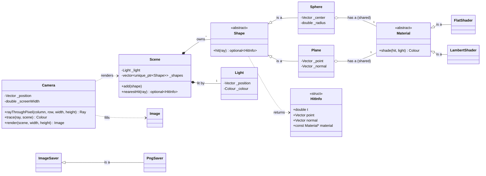

# Domain model

The concepts of the raytracer and how they relate. The first sketch is in
[the discovery report](discovery/discovery-report.md#shaping-the-domain-model);
this is the model as it is in the code today. The decisions behind it are in
[ADR 0007](adr/0007-shape-has-a-material.md).

## Concepts

| Concept | What it is | In the code |
|---|---|---|
| Vector | Three numbers: a point or a direction in 3D | `math/vector` |
| Ray | A start point O and a direction D; its points are O + t × D | `ray/ray` |
| Shape | Anything a ray can hit; gives the nearest hit with t > 0 | `geometry/shape` |
| Sphere, Plane | The two shapes so far | `geometry/sphere`, `geometry/plane` |
| HitInfo | Where a ray hits a shape: t, point, unit normal, material | `geometry/hit_info` |
| Material | How a surface turns light into a colour (Strategy) | `material/material` |
| FlatShader, LambertShader | One colour always; colour × max(0, N · L) | `material/` |
| Light | A point light: a position and a colour | `light/light` |
| Scene | The shapes and the light; finds the nearest hit | `scene/scene` |
| Camera | Makes one ray per pixel, traces it, fills the image | `camera/camera` |
| Image, ImageSaver, PngSaver | The grid of colours and how it is written to disk | `image/`, `io/` |

## How one pixel is computed

1. `Camera::render` loops over the pixels and asks `rayThroughPixel` for a ray.
2. `Camera::trace` asks `Scene::nearestHit`, which asks every `Shape::hit` and
   keeps the smallest t.
3. No hit: the pixel is black. A hit: its material's `shade(hit, light)`
   gives the colour.
4. `PngSaver` writes the finished `Image` to `output.png`.
